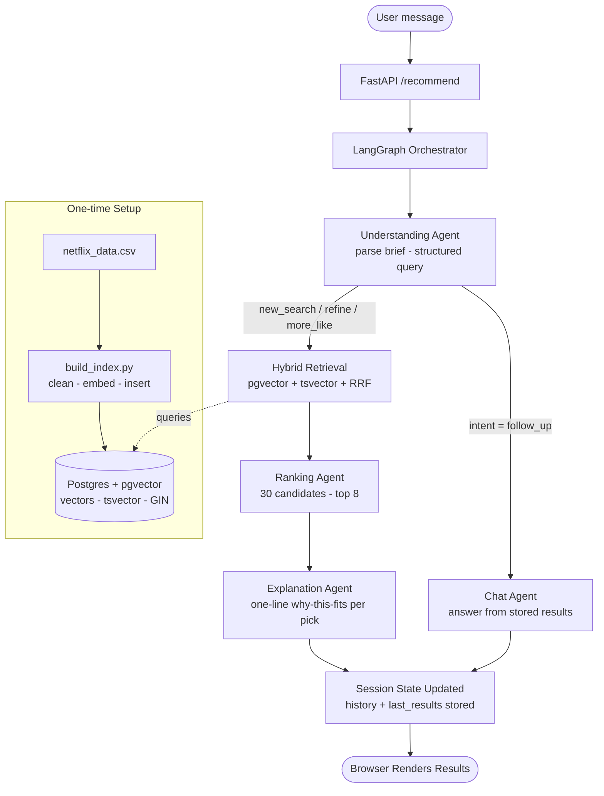

# Movie Recommender — Multi-Agent Netflix Matcher

A conversational recommender that maps natural-language briefs to ranked titles from a Netflix catalog. Built as a co-op assessment for TeloHive's AI Agent role.

---

## Running (Docker — for submission)

```bash
docker build -t movie-recommender .
docker run -p 8080:80 -e OPENAI_API_KEY=sk-... movie-recommender
```

Open **http://localhost:8080** when you see `Application startup complete.`

> First run builds the embedding index (~3 minutes, ~$0.05 in OpenAI credits). The container bundles Postgres + pgvector + FastAPI in a single image — an anti-pattern in production, required by the two-command spec. See `docker-compose.yml` for the correct production split.

**AI setup — reviewer must supply their own OpenAI API key via the `-e` flag above.**
- Provider: OpenAI
- Chat model: `gpt-4o`
- Embedding model: `text-embedding-3-small`

---

## What makes this different from a single-query recommender

Standard approach: embed the catalog, embed the query, cosine-similarity the whole thing, done. Works okay for simple queries, falls apart on "dark psychological thriller like Mindhunter, but only TV shows, and nothing supernatural."

This system decomposes the problem into five specialized agents, each with one job, wired through a LangGraph orchestrator that also handles multi-turn conversation.



> See `docs/architecture.png` for a detailed hand-drawn version of the full pipeline.

### The five agents

| Agent | Role | Model | Why it's separate |
|---|---|---|---|
| **Understanding** | Parse raw brief → structured ParsedQuery (intent, type, genres, era, exclusions, reference titles) | GPT-4o | Everything downstream depends on correct intent classification |
| **Retrieval** | Hybrid search over pgvector + Postgres FTS, RRF fusion, filter relaxation on empty | None (pure SQL) | Optimizes for recall, deterministic, cheap |
| **Ranking** | Reduce 30 candidates → top 8 with 0–100 scores | GPT-4o | Optimizes for precision, judgment-heavy, LLM does the nuance work |
| **Explanation** | Polished one-line "why this matches your brief" per pick | GPT-4o | Voice/tone is different enough from ranking to warrant its own prompt |
| **Chat** (follow-ups) | Answer questions about previously-shown results without re-running retrieval | GPT-4o | Keeps follow-up latency under 2s and prevents drift |

---

## Stack

- **Python 3.11+** with `uv` for env management
- **FastAPI** + `asyncpg` for the API layer
- **PostgreSQL 16 + pgvector** for hybrid semantic + keyword search, run via Docker Compose
- **LangGraph** for agent orchestration with intent-based routing
- **OpenAI API** — GPT-4o for all agents, `text-embedding-3-small` (1536-dim) for the index
- **Plain HTML + JS** for the minimal UI, served by FastAPI

---

## Running locally (dev)

```bash
# 1. Install dependencies
uv sync

# 2. Configure secrets
cp .env.example .env
# Edit .env — add OPENAI_API_KEY

# 3. Start Postgres only (runs schema.sql automatically on first boot)
docker compose up -d

# 4. Build the index — reads netflix_data.csv, embeds, bulk-inserts (~3 min, ~$0.05)
uv run python data/build_index.py

# 5. Start the server
uv run uvicorn app.main:app --host 0.0.0.0 --port 8080 --reload

# 6. Open http://localhost:8080
```

---

## Query handling — how natural language becomes SQL

The Understanding agent uses structured output (`response_format=json_schema`) to guarantee its output is a valid `ParsedQuery`. No regex, no string parsing.

Example:

> "Korean rom-com series, nothing too recent"

becomes:

```python
ParsedQuery(
    semantic_query="Korean romantic comedy",
    intent="new_search",
    type="TV Show",
    genres=["Korean TV Shows", "Romantic TV Shows"],
    mood_keywords=["feel-good"],
    era_end=2020,
    reference_titles=[],
)
```

The retrieval layer converts this into a single SQL query that combines:
- Hard filters (`type`, `genres @> $2`, `release_year <=`)
- Semantic ranking via pgvector: `ORDER BY embedding <=> query_vec`
- Keyword ranking via Postgres FTS: `ts_rank(search_tsv, plainto_tsquery(...))`
- Fused with Reciprocal Rank Fusion in Python (standard RRF with k=60)

For multi-turn refinements like "something more recent please", the Understanding agent preserves `type` and `genres` from the prior turn and only adds/changes what the user explicitly mentioned.

---

## Design decisions worth calling out

**Denormalized schema with Postgres arrays**: `cast_members`, `genres`, and `director` are stored as `text[]` with GIN indexes, not as normalized join tables. For a static, read-only dataset at this scale, arrays keep queries simple and co-locate all fields needed per row. I'd normalize for a production system with editable data.

**Trigger-populated `search_tsv`** instead of a generated column: Postgres's immutability rules reject `to_tsvector` + `array_to_string` in a `GENERATED ALWAYS AS ... STORED` column. A `BEFORE INSERT OR UPDATE` trigger produces identical output with no downside.

**Hybrid retrieval**: pure semantic search loses exact-title queries ("Inception" ranks behind movies that mention Inception in their description). Pure keyword loses vibe queries. RRF fusion combines both rank lists, which handles both failure modes.

**Filter relaxation**: if the initial SQL returns fewer than 5 candidates, retrieval drops filters in order (era → genres → type) and retries. This prevents "zero results" on legitimate but over-constrained queries.

**History only on refinements**: the Ranking agent gets conversation history only when intent is `refine` or `more_like`. For `new_search`, history is noise. This is why "forget that, I want a Korean rom-com" genuinely forgets the previous topic.

**Follow-ups bypass retrieval entirely**: when intent is `follow_up`, the graph skips retrieval/ranking/explanation and hands the stored previous results to the Chat agent. This keeps "tell me more about the first one" under 2 seconds vs ~10 for a full pipeline run.

**Single Docker image**: the container bundles Postgres + pgvector + FastAPI to satisfy the two-command spec. In production this would be two separate services orchestrated by docker-compose or Kubernetes — the `docker-compose.yml` in the repo shows the correct split.

---

## Evaluation

An LLM-as-judge harness scores results on 12 briefs across four dimensions (relevance, vibe match, explanation quality, confidence). GPT-4o is the judge, temperature=0 throughout for reproducibility.

### Results

| Metric | Score (/5) |
|---|---|
| Relevance | 4.45 |
| Vibe Match | 4.18 |
| Explanation Quality | 4.57 |
| Confidence | 4.08 |

Run it yourself:

```bash
uv run python eval/run_eval.py
```

Outputs go to `eval/results/` as both JSON and markdown. See `eval/results/latest.md` for the most recent full report.

---

## Project structure

```
movie-recommender/
├── Dockerfile                  # Single-image build (Postgres + FastAPI)
├── docker-compose.yml          # Postgres only — for local dev
├── docker/
│   └── entrypoint.sh           # Container startup script
├── app/
│   ├── main.py                 # HTTP layer, /recommend endpoint
│   ├── orchestrator.py         # LangGraph wiring + session state
│   ├── retrieval.py            # Hybrid SQL retrieval with RRF
│   ├── db.py                   # asyncpg connection pool
│   ├── config.py               # Environment settings
│   └── models.py               # Shared Pydantic schemas
├── agents/
│   ├── understanding.py        # Brief → ParsedQuery (structured output)
│   ├── ranking.py              # 30 candidates → top 8 with scores
│   ├── explanation.py          # Polished one-line reasons
│   └── chat.py                 # Follow-up answers from stored context
├── data/
│   ├── schema.sql              # pgvector + trigger-populated tsvector
│   ├── build_index.py          # One-shot CSV → embeddings → Postgres
│   └── netflix_data.csv        # 8,807 Netflix titles
├── ui/
│   └── index.html              # Single-page conversational UI
├── eval/
│   ├── test_briefs.json        # 12-brief evaluation set
│   ├── run_eval.py             # LLM-as-judge harness
│   └── results/                # JSON + markdown reports
├── docs/
│   └── architecture.png        # Hand-drawn pipeline diagram
├── tests/                      # Per-agent isolation tests
├── pyproject.toml
└── uv.lock
```

---

## What I'd add with more time

- **Exact-title pre-check** — run a fast `WHERE lower(title) = lower($query)` lookup before the hybrid pipeline and pin the exact match to position 1. Eliminates the Breaking Bad ranking edge case.
- **Hard-negative training for embeddings** — evaluate `voyage-3-large` against `text-embedding-3-small` on the eval set and measure the lift.
- **Dedicated negative-preference field** in ParsedQuery, fed into the ranker explicitly rather than relying on semantic proximity for soft qualifiers like "less confusing."
- **Redis-backed session store** — the current in-memory dict is fine for one user, not for production.
- **Streaming responses** — the full pipeline takes ~8–12s end-to-end; streaming the ranking/explanation phases would make it feel interactive.
- **Embedding cache** — the same query fires a fresh API call every time; a trivial LRU cache would pay for itself immediately.
